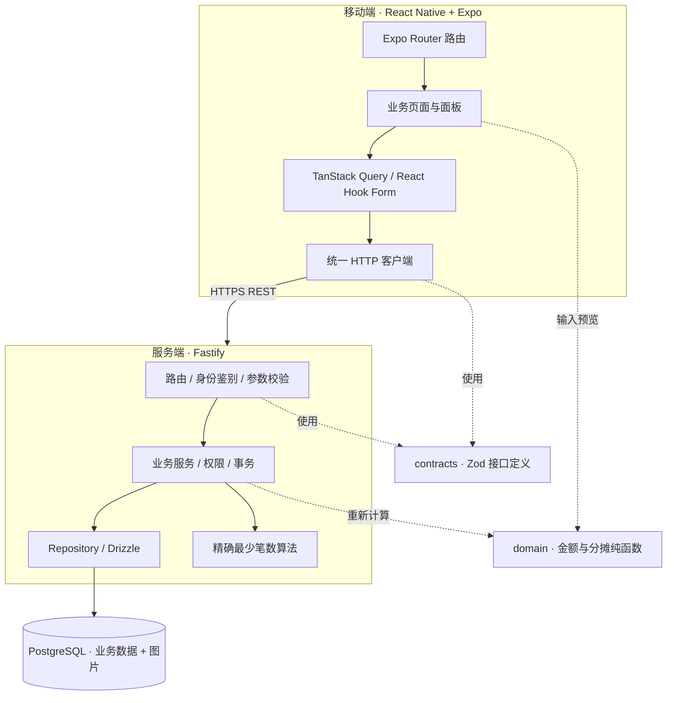

# 同账 · 项目架构与目录结构

版本：首版开发基线 v1.0 · 2026-10-13

本文确定工程选型、目录和开发边界。业务细节沿用《同账-原型使用说明与功能设计文档》；早期方案中的候选技术，以本文为准。本文保留完整目标架构；当前实现范围与实际可用命令以 README 和 development.md 为准。

模块具体职责、接口与事务划分见 [模块架构与开发入口](modules/README.md)。

## 1. 架构决定

采用 **pnpm Monorepo + React Native / Expo 移动端 + Fastify 模块化单体 API + PostgreSQL**。

- 一个 Git 仓库，两个独立应用：`mobile`、`api`。
- 两个共享包：`contracts` 保存接口契约，`domain` 保存金额与分摊纯函数。
- 服务端按业务模块划分，统一部署为一个进程；数据库只有一个 PostgreSQL 实例。
- 移动端负责交互和输入预览，服务端负责权限、最终计算、状态变更和持久化。
- 首版以 Android 安装包作为联调与课程验收基线，代码保留 iOS 兼容；iOS 签名分发另行配置。
- 首版不增加 Web 应用、微服务、Redis、消息队列、本地业务数据库或离线同步。



Expo 官方支持 pnpm workspace 和共享包；工程使用标准工作区配置，不额外手写复杂的 Metro 模块解析规则。[Expo Monorepo 文档](https://docs.expo.dev/guides/monorepos/)

## 2. 技术选型

| 范围              | 定案                                                    | 项目中的用途                                         |
| ----------------- | ------------------------------------------------------- | ---------------------------------------------------- |
| 运行时与包管理    | Node.js 24 LTS、pnpm workspace                          | API 运行、依赖管理、工作区脚本                       |
| 语言              | TypeScript，开启 `strict`                               | 前后端及共享包统一类型检查                           |
| 移动端            | React Native + Expo                                     | Android / iOS 原生应用                               |
| 导航              | Expo Router                                             | 登录区、主导航、业务详情路由                         |
| UI                | React Native 基础组件 + `StyleSheet`                    | 按 Figma 实现自有组件，不引入整套视觉组件库          |
| 图标与简单图表    | `react-native-svg`                                      | 统一线性图标、类别饼图；图标颜色由组件属性控制       |
| 服务端数据状态    | TanStack Query                                          | 查询、刷新、提交结果及相关列表失效                   |
| 表单              | React Hook Form + Zod                                   | 输入、字段错误、分摊表单；提交失败保留当前输入       |
| 本地 UI 状态      | React `useState` / Context                              | 弹窗、筛选条件、登录会话；首版不增加 Redux / Zustand |
| HTTP              | 原生 `fetch` 的薄封装                                   | 认证头、超时、错误转换、幂等键                       |
| 服务端            | Fastify 5                                               | HTTP 路由、插件、日志、请求生命周期                  |
| 接口校验          | Zod 4 + `fastify-type-provider-zod`                     | 请求与响应运行时校验、TypeScript 类型推导            |
| 接口文档          | `@fastify/swagger` + Swagger UI                         | 从路由 Schema 生成 OpenAPI，开发环境查看             |
| 数据库            | PostgreSQL 17                                           | 事务、约束、业务记录、图片二进制                     |
| 数据库访问        | Drizzle ORM + `pg`                                      | 类型化查询、显式事务；复杂约束和锁使用 SQL           |
| 数据库迁移        | Drizzle Kit + 已提交的 SQL 迁移                         | 开发、测试、部署使用同一版本的表结构                 |
| 认证              | 随机会话令牌 + PostgreSQL 会话表                        | Bearer Token 鉴权、到期校验、退出撤销                |
| 密码              | Argon2id                                                | 保存密码哈希                                         |
| 图片              | 独立图片表 `bytea`                                      | 封面、收据；业务表只引用图片 ID                      |
| 质量检查          | ESLint、Prettier、TypeScript                            | 代码约束、格式、类型检查                             |
| 测试              | Vitest；移动端 Jest Expo + React Native Testing Library | 金额算法、API 集成、关键表单交互                     |
| 本地数据库 / 部署 | Docker Compose                                          | 本地 PostgreSQL；服务器 API + PostgreSQL + Caddy     |

**版本管理：** Node 固定 24 系列，pnpm 具体版本写入根 `packageManager`；Expo 使用搭建时稳定 SDK 配套的 React / React Native 版本，通过 `expo install` 安装原生依赖。依赖组合验证后提交唯一的 `pnpm-lock.yaml`，CI 使用冻结锁文件安装，不单独追升 React Native。

`fastify-type-provider-zod` 是社区维护的适配器，搭建时按其兼容表锁定 Zod / Fastify 配套版本；请求、响应和 OpenAPI 转换一并验证。[适配器文档](https://github.com/turkerdev/fastify-type-provider-zod)

选 Drizzle 的原因是本项目需要明确控制事务、行锁、整数金额和图片字段；SQL 及迁移文件也便于课程展示与排查。[Drizzle 事务文档](https://orm.drizzle.team/docs/transactions)

## 3. 仓库目录

仓库目录名使用 `tongzhang`，包名统一使用 `@tongzhang/` 前缀。

```text
tongzhang/
├── apps/
│   ├── mobile/                    # @tongzhang/mobile
│   │   ├── app/                   # Expo Router：路由、布局、导航守卫
│   │   ├── src/
│   │   │   ├── features/          # 按业务组织的页面、面板、查询与表单
│   │   │   ├── components/        # Button、Input、Card、Sheet、Toast 等
│   │   │   ├── theme/             # 颜色、字体、间距、圆角、阴影
│   │   │   ├── icons/             # Figma 线性图标的 SVG 组件
│   │   │   ├── lib/               # http、query-client、session、network
│   │   │   └── providers/         # 会话、QueryClient、全局反馈
│   │   ├── assets/                # 字体、启动图、预设封面
│   │   ├── app.config.ts
│   │   ├── eas.json               # development / preview / production
│   │   ├── .env.example
│   │   └── package.json
│   └── server/                    # @tongzhang/server
│       ├── src/
│       │   ├── app.ts             # 创建 Fastify 实例，供运行与测试共用
│       │   ├── server.ts          # 启动监听、关闭信号
│       │   ├── config/            # 环境变量解析与校验
│       │   ├── http/              # 契约路由适配、请求上下文、错误处理、健康检查
│       │   ├── db/                # 连接、表定义、事务、幂等锁、审计写入
│       │   │   ├── client.ts
│       │   │   └── schema/        # 数据库表定义
│       │   ├── modules/           # 业务模块：routes、service、repository
│       │   └── jobs/             # 临时图片、过期会话等清理任务
│       ├── drizzle/              # SQL 迁移与迁移元数据
│       ├── tests/                # 服务端单元、集成测试与数据库夹具
│       ├── drizzle.config.ts
│       ├── .env.example
│       └── package.json
├── packages/
│   ├── contracts/                # @tongzhang/contracts
│   │   ├── src/
│   │   │   ├── http.ts           # 错误结构、响应包装、分页
│   │   │   ├── scalars.ts        # ID、时间、金额字符串、枚举
│   │   │   ├── limits.ts         # 人数、金额、图片大小上限
│   │   │   ├── system.ts         # 健康检查
│   │   │   ├── auth.ts
│   │   │   ├── profile.ts
│   │   │   ├── ledgers.ts
│   │   │   ├── invitations.ts
│   │   │   ├── expenses.ts
│   │   │   ├── images.ts
│   │   │   ├── balances.ts
│   │   │   ├── settlements.ts
│   │   │   ├── endpoints.ts      # 接口登记表
│   │   │   └── index.ts
│   │   └── package.json
│   └── domain/                   # @tongzhang/domain
│       ├── src/
│       │   ├── money.ts          # 十进制金额解析、格式化、边界检查
│       │   ├── limits.ts         # 人数与单笔金额上限
│       │   ├── split.ts          # 人均、按份、按金额与余分分配
│       │   └── index.ts
│       ├── tests/
│       └── package.json
├── docs/
│   ├── architecture.md           # 本文
│   ├── product-spec.md           # 功能与权限基线
│   ├── prototype-guide.md        # 原型链接与操作说明
│   └── development.md            # 环境、启动、迁移、真机联调
├── infra/
│   ├── compose.dev.yml          # 本地 PostgreSQL
│   ├── compose.prod.yml         # API、PostgreSQL、反向代理
│   ├── server.Dockerfile
│   ├── deploy.sh                # 拉取镜像、备份、迁移与健康验收
│   └── Caddyfile
├── scripts/                     # 环境初始化、开发进程编排与容器验证
├── .github/workflows/            # 持续验证与镜像发布
├── .gitignore
├── .node-version
├── pnpm-workspace.yaml
├── pnpm-lock.yaml
├── package.json
├── tsconfig.base.json
├── eslint.config.mjs
├── .prettierrc.json
├── AGENTS.md                     # Agent 的目录边界、业务约束、检查命令
└── README.md
```

目录按首个用例逐步创建，不预先堆放空的服务类。暂不拆 `ui`、`db`、`api-client` 等独立包：移动端只有一个，数据库也只有 API 使用。

### 3.1 依赖规则

```text
mobile ──→ contracts
       └─→ domain
api    ──→ contracts
       └─→ domain
```

- `contracts` 只依赖 Zod 等跨端基础库；`domain` 为无 I/O 的纯 TypeScript。
- 共享包禁止引入 Fastify、数据库驱动、Node 文件 API 或 React Native。
- 移动端禁止导入 API 源码、Drizzle 表模型和密码字段；数据库实体不直接充当接口响应。
- 共享包通过 `workspace:*` 和明确的包导出使用，不跨目录相对路径导入源码。
- 共享包统一编译到 `dist`；开发时启动其 watch，CI 先构建共享包再检查应用。

## 4. 移动端组织

### 4.1 路由结构

```text
apps/mobile/app/
├── _layout.tsx                          # 根 Provider、登录态恢复、访问守卫
├── (auth)/
│   ├── _layout.tsx
│   ├── welcome.tsx
│   ├── login.tsx
│   └── register.tsx
└── (app)/                              # 必须在线验证会话的业务区
    ├── _layout.tsx
    ├── (tabs)/
    │   ├── _layout.tsx
    │   ├── index.tsx                   # 我的账本
    │   └── profile.tsx                 # 我的
    ├── ledgers/
    │   ├── new.tsx
    │   ├── history.tsx
    │   └── [ledgerId]/
    │       ├── index.tsx               # 状态决定进行中/结算中/已结清展示
    │       ├── invite.tsx
    │       ├── balances.tsx
    │       ├── statistics.tsx
    │       ├── settlement.tsx          # 预览/正式方案，读取实际状态
    │       └── expenses/
    │           ├── new.tsx
    │           └── [expenseId]/
    │               ├── index.tsx
    │               └── edit.tsx
    ├── join/
    │   ├── index.tsx
    │   └── scan.tsx
    └── settings/
        ├── account.tsx
        └── app.tsx
```

路由文件只读取参数、组装导航并导出业务 Screen；不在里面写金额算法、请求实现或大段表单。

**原型画板不等于路由。** 以下统一作为当前页组件：

| 类型                                   | 实现位置                                      |
| -------------------------------------- | --------------------------------------------- |
| 分摊方式选择、每人分摊预览             | 同一个 `SplitEditorSheet`，确认后回填记账表单 |
| 类别、付款人、日期、流水筛选、成员列表 | 当前业务模块的 Sheet / Picker                 |
| 删除、冻结、登记已还、结清、归档确认   | Dialog / Sheet                                |
| 加载、空数据、网络错误、字段错误       | 所属页面或字段状态                            |
| 已复制、已删除、已归档                 | Toast；归档反馈可带历史账本入口               |
| 协议、关于、收据查看                   | 阅读或预览面板                                |
| 分享邀请                               | 直接调用系统分享，不增加自定义二级选择页      |

账本结清后仍使用原账本地址，转账记录卡片显示登记时间，不重建独立的“登记记录”页面。

### 4.2 业务目录

`src/features/` 使用 `auth`、`ledgers`、`invitations`、`expenses`、`settlements`、`balances`、`profile`。

以记账为例：

```text
features/expenses/
├── screens/
│   ├── ExpenseFormScreen.tsx       # 新增和编辑共用
│   └── ExpenseDetailScreen.tsx
├── components/
│   ├── ExpenseForm.tsx
│   ├── SplitEditorSheet.tsx
│   ├── ExpenseFilterSheet.tsx
│   └── ReceiptPicker.tsx
├── api.ts                         # 本模块 HTTP 调用
├── queries.ts                     # Query Key、查询、提交及失效策略
├── form.ts                        # 表单值与 API DTO 转换
└── index.ts                       # 对外入口
```

跨页面通用视觉组件进入 `components`；只服务记账的控件留在 `expenses`。所有页面使用同一套颜色、间距、图标尺寸与按钮状态。

### 4.3 状态归属

| 数据                             | 存放方式                                   |
| -------------------------------- | ------------------------------------------ |
| 账本、流水、余额、统计、结算记录 | TanStack Query 内存缓存，服务端为事实来源  |
| 金额、备注、分摊人等未提交输入   | React Hook Form，当前页面内存              |
| 面板开关、当前筛选项             | 页面局部状态                               |
| 登录令牌                         | Expo SecureStore；用户资料每次启动在线校验 |
| 设计 Token、图标、预设封面       | 应用资源                                   |

新增或修改消费成功后，失效该账本的详情、流水、余额、统计和结算预览查询。首版不对金额和还款使用乐观更新，成功提示以服务器返回为准。

### 4.4 在线约束

- 不持久化 Query 缓存、表单草稿或业务图片缓存；图片采用内存缓存或禁用磁盘缓存。
- 断网时禁止业务访问与提交，使用原页面网络状态；保留已输入表单的内存内容供手动重试，退出页面不承诺保留。
- 不将变更请求暂停入队，也不在恢复网络后自动补交。Mutation 明确配置 `networkMode: 'always'`、`retry: false`，并在请求封装中检查连通性、处理超时；网络检查不能替代真实请求错误处理。
- 网络恢复后可重新读取服务端数据；写操作必须由用户重新触发。
- 请求超时不代表服务器没有保存。结果不确定时，保留相同请求的幂等键，先重试确认结果；不直接生成新键重复提交。
- 退出登录或切换账号时清空全部业务内存缓存、表单和令牌。

TanStack Query 的网络模式会影响暂停与恢复行为，因此不能仅依靠默认配置满足本项目的“无自动补交”要求。[网络模式说明](https://tanstack.com/query/v4/docs/framework/react/guides/network-mode)

## 5. 服务端组织

### 5.1 模块边界

| `modules/` 子目录 | 职责                                                   |
| ----------------- | ------------------------------------------------------ |
| `auth`            | 注册、登录、会话验证、退出登录                         |
| `profile`         | 当前用户资料、通知偏好                                 |
| `ledgers`         | 创建、列表、详情、成员查询、个人归档、公共成员权限检查 |
| `invitations`     | 邀请码、二维码载荷、重置、加入预览与确认加入           |
| `expenses`        | 新增、编辑、删除、流水筛选、分摊明细                   |
| `balances`        | 总支出、成员余额、类别统计、成员已付与应摊             |
| `settlements`     | 预览、最少笔数计算、正式冻结、已还登记、整本结清       |
| `images`          | 图片上传、访问校验、二进制读取、临时图片清理           |

审计写入不是独立业务模块，由 `db/audit.ts` 提供，在业务事务内与业务写入共用 `tx`；首版不提供动态信息流。健康检查与系统信息属于 `http/system.ts`，不放入 `modules/`。

账本状态转换统一由 `settlements` 服务管理；通用成员访问检查由 `ledgers` 提供。模块不能绕过对应服务直接修改别的模块的业务状态。

### 5.2 模块内部

```text
modules/expenses/
├── index.ts                 # 注册模块路由，导出必要服务
├── routes.ts                # HTTP 参数、Schema、状态码
├── service.ts               # 权限、账本状态、事务、业务规则
├── repository.ts            # 查询和写入；接收 db 或事务 tx
├── mapper.ts                # 数据库实体 → 安全的响应 DTO
└── service.test.ts          # 有实际业务规则时添加测试

modules/settlements/
├── index.ts
├── routes.ts
├── service.ts
├── repository.ts
├── mapper.ts
├── algorithm.ts             # 净额分组 DP 与转账方案重建
└── algorithm.test.ts
```

请求顺序：**路由校验 → 身份与成员权限 → 服务处理 → Repository / SQL → DTO 响应**。

业务事务由 service 开启，涉及的 Repository 与审计写入共用同一个 `tx`。不引入通用 BaseService、BaseRepository、依赖注入容器或空接口层。单纯查询可以保持较短的实现。

Fastify 的数据库和错误插件先注册，业务模块随后注册。`http/`、`db/`、`config/` 不依赖任何业务模块：会话校验由 `auth` 模块通过 `app.authenticate` 装饰器注入，跨模块只导入对方的 `index.ts` 出口，ESLint 强制执行这两条规则。[Fastify 插件指南](https://fastify.dev/docs/latest/Guides/Plugins-Guide/)

## 6. 数据、认证与接口约定

### 6.1 数据库归属

表定义全部放 `apps/server/src/db/schema/`，集中在 `tables.ts`，避免相互引用的复合外键分散后产生循环初始化问题。

核心表延续现有类图：`users`、`ledgers`、`ledger_members`、`invitations`、`expenses`、`expense_splits`、`settlement_batches`、`settlement_transfers`、`image_assets`、`expense_images`、`operation_logs`。

工程补充两张技术表：

| 表                 | 关键字段与用途                                                                                                          |
| ------------------ | ----------------------------------------------------------------------------------------------------------------------- |
| `auth_sessions`    | `id`、`user_id`、`token_hash`、`created_at`、`expires_at`、`revoked_at`；控制会话有效性                                 |
| `idempotency_keys` | `user_id`、`operation`、`key`、`request_hash`、`response_status`、`response_body`、`expires_at`；记录已完成写操作的结果 |

金额 `BIGINT`；运行时使用 `bigint`；JSON 中使用整数分字符串。例如 `¥120.00 → 12000n → "12000"`。禁止将 `bigint` 直接交给 JSON 序列化，也不通过浮点数计算金额。

日期型消费时间使用 `YYYY-MM-DD`；操作发生时间保存为 PostgreSQL `timestamptz`，API 使用 UTC ISO 时间，界面按设备时区展示。成员余额由消费与已还记录派生，不另存一份可独立修改的余额。

### 6.2 登录会话

1. 注册或登录成功，服务器生成密码学安全的 256 位随机令牌。
2. 原令牌仅返回客户端，数据库保存 SHA-256 摘要和有效期；会话固定有效 30 天，到期重新登录。
3. App 用 SecureStore 保存令牌，请求携带 `Authorization: Bearer <token>`。
4. API 每次验证摘要对应的会话未过期、未撤销，再获取用户身份。
5. 在线退出撤销当前会话并清除本地状态；本地清除失败或服务端失败均给出明确反馈，不声称已完成服务端撤销。

首版无需 JWT / Refresh Token 双令牌刷新流程。数据库本就参与业务请求，集中会话便于立即撤销和排查。令牌、密码和完整图片不进入日志；登录与邀请码查询配置限流。

SecureStore 用于小型敏感凭据，不承载账本内容。[Expo SecureStore 文档](https://docs.expo.dev/versions/latest/sdk/securestore/)

### 6.3 API 约定

- REST API 统一前缀 `/api/v1`；JSON 字段用 `camelCase`，数据库列名用 `snake_case`。
- `contracts` 定义请求和响应 Schema，由 `z.infer` 推导 DTO；客户端表单 Schema 可扩展确认密码等界面字段。
- 成功返回 `{ "data": ... }`；列表返回 `{ "data": [...], "page": { "nextCursor": ... } }`。
- 错误返回 `{ "error": { "code": "...", "message": "...", "fieldErrors": {} }, "requestId": "..." }`。
- 常用错误：`VALIDATION_ERROR`、`UNAUTHENTICATED`、`FORBIDDEN`、`LEDGER_FROZEN`、`VERSION_CONFLICT`、`INVITE_EXPIRED`、`MEMBER_LIMIT_REACHED`。
- 分页按日期和 ID 构成稳定顺序；筛选、分页在服务端执行，不一次下载全部流水。
- `401` 引导重新登录；字段错误留在表单；版本冲突提示刷新；网络错误留在原页重试。

接口分组：

| 分组 | 主要入口                                                                                                                                                          |
| ---- | ----------------------------------------------------------------------------------------------------------------------------------------------------------------- |
| 账号 | `/auth/register`、`/auth/login`、`/auth/logout`、`/me`、`/me/preferences`                                                                                         |
| 账本 | `/ledgers`、`/ledgers/:ledgerId`、`/ledgers/:ledgerId/members`、`/ledgers/:ledgerId/archive`                                                                      |
| 邀请 | `/ledgers/:ledgerId/invitation`、`/invitations/preview`、`/invitations/join`                                                                                      |
| 消费 | `/ledgers/:ledgerId/expenses`、`/ledgers/:ledgerId/expenses/:expenseId`                                                                                           |
| 统计 | `/ledgers/:ledgerId/balances`、`/ledgers/:ledgerId/statistics`                                                                                                    |
| 结算 | `/ledgers/:ledgerId/settlement-preview`、`/ledgers/:ledgerId/settlement`、`/ledgers/:ledgerId/settlement/transfers/:transferId/paid`、`/ledgers/:ledgerId/settle` |
| 图片 | `/images`、`/images/:imageId`                                                                                                                                     |

二维码载荷使用版本化文本 `tongzhang:invite:v1:<6位邀请码>`，只由 App 扫码解析，不当作可点击的邀请链接。扫码与手输都调用相同的预览、加入接口。

### 6.4 并发、幂等与结算

- 消费写入、加入成员、正式结算、登记还款和结清，均在事务中先锁定账本行，再验证当前权限与状态。
- 统一锁顺序；成员数量校验在持有账本锁时执行，保证最多 12 人。
- 修改消费携带其 `version`；正式结算携带预览对应的账本 `version`。版本不匹配返回冲突，不覆盖他人更新。
- 影响结算的消费、成员变更更新账本版本。正式结算在同一事务中计算快照、写入方案并冻结账本。
- 写请求使用 `Idempotency-Key`。幂等记录按“用户 + 操作 + 键”唯一；成功结果与业务数据在同一事务提交，同键不同请求内容返回冲突。
- 幂等结果保留 7 天；客户端仅在结果不确定且 24 小时内复用原键重试。超过窗口先查询业务结果，不盲目重交。
- 结算算法只放 API：去零净额 → 零和子集 DP → 最大零和分组 → 组内转账重建。`n ≤ 12`，最少笔数为 `n − 最大零和组数`。
- `ACTIVE → SETTLING → SETTLED`。预览不冻结；所有转账登记后仍由创建者确认结清；归档只修改本人 `ledger_members.archived_at`。

客户端分摊预览复用 `domain`；API 保存时独立重算并校验，不能信任客户端传来的净额或自动分摊结果。

### 6.5 图片链路

1. App 选择图片并压缩为 JPEG / PNG；首版单张上限 1 MB，每笔消费最多一张收据。
2. 使用 `multipart/form-data` 上传，API 校验实际文件类型、尺寸与字节上限。
3. `image_assets` 保存二进制、上传者、用途和归属，返回图片 ID；保存业务时在事务中确认所有权与合法引用。
4. 创建账本前的封面可暂未绑定账本，只允许上传者访问；已绑定图片仅对应账本成员可读。
5. 图片通过受鉴权的二进制接口读取，不混入列表 JSON；返回禁止持久缓存的响应头，并配合移动端图片缓存配置。
6. 临时未绑定图片超过 24 小时清理；已引用的收据不由定时任务删除。数据库备份同时覆盖图片。

图片处理临时文件只供当前上传或系统分享使用，用后清理，不构成离线账本能力。

## 7. 环境、部署与测试

### 7.1 环境

| 环境     | 运行方式                                                                          |
| -------- | --------------------------------------------------------------------------------- |
| 本地开发 | Docker 运行 PostgreSQL；API 在主机热更新；Expo Development Build 真机或模拟器联调 |
| 集成演示 | 一台 Linux 服务器，Compose 启动 Caddy、API、PostgreSQL；HTTPS 域名供真机连接      |
| 自动检查 | CI 启动独立 PostgreSQL 测试库，执行迁移、检查和测试                               |

Expo Go 可用于早期界面查看，项目联调与验收使用 Development Build / Android APK。移动端不输出 Web 构建。

客户端环境变量只保存公开配置，如 `EXPO_PUBLIC_API_BASE_URL`；数据库口令等仅在服务端。真机不能用电脑的 `localhost` 地址，开发文档需给出局域网地址配置方式。

服务器数据库不暴露公网端口；API 记录请求 ID 与脱敏日志，提供存活及数据库就绪检查。迁移由部署步骤单独执行，不让每个 API 进程在启动时自行修改表结构。每日备份并在验收前完成一次恢复检查。

### 7.2 运行与发布入口

配置与可执行操作以 [开发与部署说明](development.md) 为准。

| 命令                                   | 职责                                                       |
| -------------------------------------- | ---------------------------------------------------------- |
| `pnpm install --frozen-lockfile`       | 安装锁定依赖                                               |
| `pnpm setup`                           | 创建缺失的开发配置、启动数据库、首次迁移                   |
| `pnpm db:up` / `db:down`               | 开发数据库启动/停止，保留卷                                |
| `pnpm db:generate` / `db:migrate`      | 生成待审查迁移 / 应用已提交迁移                            |
| `pnpm dev` / `dev:ios` / `dev:android` | 首次编译后启动共享包、API、Metro；平台入口由 Expo 打开 App |
| `pnpm ios:build` / `android:build`     | Prebuild 后编译安装开发客户端，不启动 Metro                |
| `pnpm check` / `test`                  | 静态检查 / 无数据库测试                                    |
| `pnpm test:integration`                | 显式使用 TEST_DATABASE_URL 的真实数据库测试                |
| `pnpm build:server` / `mobile:export`  | 服务端构建 / 两个原生平台的 JS 导出                        |
| `pnpm container:test`                  | 对已构建镜像进行隔离数据库、迁移、HTTP 和原生依赖验证      |
| `bash infra/deploy.sh`                 | 生产镜像拉取、备份、独立迁移、更新及 HTTPS 验收            |

开发 API 与 Compose 共用服务端 `.env` 的 PG* 参数；移动端只有公开配置。生产配置由 Compose 显式注入，服务器只运行发布镜像，不现场编译。普通 CI 不部署生产，镜像发布为独立手动工作流。开发启动不执行迁移、不编译原生 App、不管理模拟器内部配置。

### 7.3 必须覆盖的验证

| 范围           | 核心验证                                                         |
| -------------- | ---------------------------------------------------------------- |
| 金额与分摊     | 小数解析、余分守恒、按份、部分成员、自定义合计错误               |
| 结算算法       | 全零、单对、多组零和、相同金额、12 人边界、贪心非最优反例        |
| 真实数据库事务 | 消费与分摊原子提交、非成员拒绝访问、满员并发加入、冻结与记账竞争 |
| 重复提交       | 新增消费、正式结算、已还登记重复请求不重复产生效果               |
| 移动端         | 表单错误不跳页、分摊确认回填、断网禁止提交、重试保留输入         |
| 完整流程       | 四账号建账本、三笔消费、结算、复制、登记、结清、归档后查看       |

API 使用 `Fastify.inject()` 测试 HTTP 行为，事务与约束使用真实 PostgreSQL，不用 SQLite 模拟。

验收样例：总消费 ¥300，净额小安 +¥30、小白 +¥60、小陈 −¥30、小丁 −¥60；生成小陈 → 小安 ¥30、小丁 → 小白 ¥60，两笔共 ¥90；登记还款后总消费仍为 ¥300。

## 8. 搭建与团队顺序

| 阶段          | 交付物                                      | 完成标准                                        |
| ------------- | ------------------------------------------- | ----------------------------------------------- |
| 1. 工程骨架   | workspace、两个应用、两个共享包、数据库、CI | 真机能请求 API 健康接口；共享包变更可被两端识别 |
| 2. 基础能力   | 契约、迁移、认证、错误响应、主题组件        | 注册登录成功，API 从会话识别用户；错误留在表单  |
| 3. 首条业务链 | 建账本、邀请、四账号加入、记一笔            | 数据落库，其他成员刷新后能看到同一消费          |
| 4. 核心账务   | 三种分摊、编辑删除、筛选、余额、统计        | 金额与手算一致，权限和冻结前置条件正确          |
| 5. 结算闭环   | 精确方案、复制、冻结、登记、结清、归档      | “鼓山一日”完整路径通过，重复提交不产生重复记录  |
| 6. 验收打包   | 图片、异常状态补齐、安装包、使用文档        | 真机在线完整演示，备份可恢复                    |

三人分工保持业务完整：

- **主程序员：** 工程、数据库、接口契约、认证、金额规则、结算算法与事务；审查迁移和关键账务改动。
- **成员 A：** 账本、成员、邀请、历史与归档；负责对应页面、接口和联调。
- **成员 B：** 记账、分摊面板、流水筛选、图片；负责对应页面、接口和联调，并承接余额、统计或结算界面。

先在 `contracts` 明确接口再各自开发；新增数据库迁移统一编号并由主程序员合并。共享组件通过小改动逐步完善，不让每个业务模块复制一份输入框和图标。

`AGENTS.md` 固定记录：金额使用分、共享包边界、页面与面板划分、在线提交约束、状态机、权限、迁移位置及必要检查命令。Agent 与成员遵守同一套工程约定。
