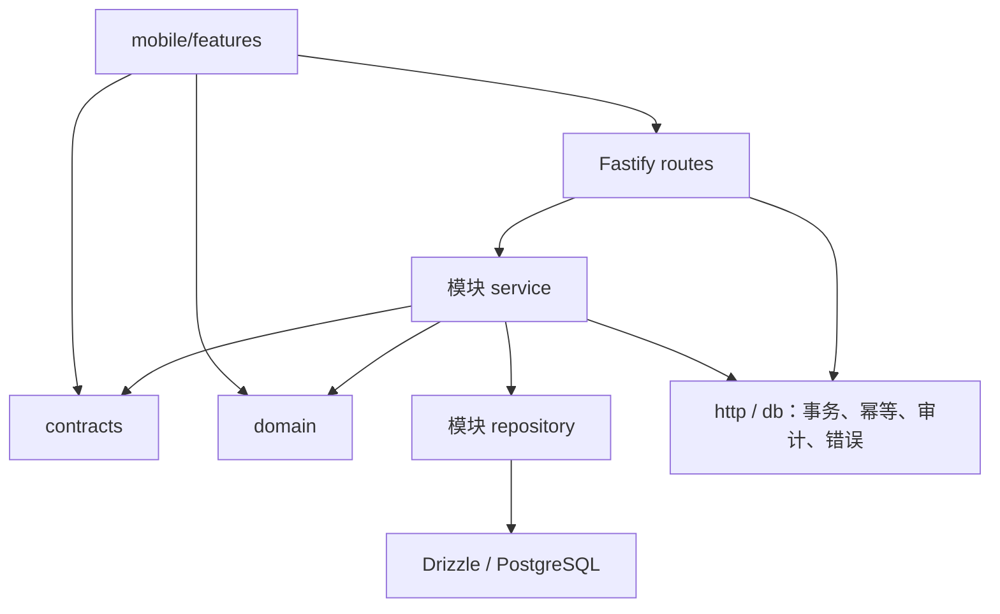

# 同账模块架构与开发入口

本目录将既定系统设计落到代码边界。技术路径为pnpm Monorepo、React Native / Expo、Fastify模块化单体、PostgreSQL；开发环境macOS / Windows，iOS本地构建使用macOS + Xcode。

## 1 模块索引

| 模块        | 子功能                       | 设计                       |
| ----------- | ---------------------------- | -------------------------- |
| auth        | 注册、登录、会话、退出       | [账号与会话](auth.md)      |
| profile     | 本人资料、通知偏好           | [个人资料](profile.md)     |
| ledgers     | 账本、成员查询、个人归档     | [账本与成员](ledgers.md)   |
| invitations | 邀请、重置、扫码/手输加入    | [成员邀请](invitations.md) |
| expenses    | 记账、三种分摊、流水、改删   | [消费与分摊](expenses.md)  |
| images      | 图片上传、授权读取、绑定清理 | [图片资产](images.md)      |
| balances    | 余额、支出与类别统计         | [余额统计](balances.md)    |
| settlements | 预览、冻结、已还、结清       | [结算](settlements.md)     |
| http/db     | 事务、幂等、权限、审计、日志 | [公共支撑](shared.md)      |

## 2 依赖方向



页面不能直连数据库；共享包不能依赖应用。API路由只负责协议接入，业务服务控制事务和权限。调用其他模块时只导入对方`index.ts`导出的服务、函数或映射，避免导入其路由或复制规则。`http/`、`db/`不导入业务模块；会话校验由auth模块注入`app.authenticate`。

## 3 代码骨架

```text
apps/server/src/
  modules/{auth,profile,ledgers,invitations,expenses,images,balances,settlements}/
    index.ts        模块出口；其他模块只能从这里导入
    routes.ts       挂载契约对应的HTTP入口
    service.ts      类型化用例接口与接入点
    repository.ts   数据访问函数，接通用例时按需添加
  http/             契约路由适配、请求上下文、AppError与错误处理、健康检查、501占位
  db/               连接与插件、事务、幂等锁、审计写入
  db/schema/        13张表、约束、索引
apps/server/drizzle/   生成的SQL及迁移元数据
apps/mobile/src/
  features/{auth,profile,ledgers,invitations,expenses,balances,settlements}/
    api.ts          类型化调用
    model.ts        面板状态联合类型
    query-keys.ts   按用户隔离的查询键（有查询的feature）
  features/images/ 原生上传/授权读取适配器
  lib/              HTTP、会话令牌、查询客户端
packages/contracts/src/  分模块Schema及29项接口登记表
packages/domain/src/     金额、分摊纯函数与人数/金额上限
```

账号的注册、登录、退出和`getMe`已接通；其余业务Service占位方法统一返回501 FEATURE_NOT_READY，不返回假账号、假账本或成功写入；受保护入口先验证真实会话。已有联调页与系统接口继续作为默认启动入口。业务页面按下表逐个接入，避免先堆放不可操作的空路由。

## 4 页面与面板边界

| 全屏页面                       | 所属feature | 同页面板/状态                        |
| ------------------------------ | ----------- | ------------------------------------ |
| 登录、注册                     | auth        | 协议、字段错误、加载                 |
| 我的账本、历史、创建、账本详情 | ledgers     | 封面选择、更多、归档确认             |
| 邀请、加入                     | invitations | 扫码、加入确认、重置确认             |
| 新增/编辑消费、消费详情        | expenses    | 分摊方式与预览、筛选、图片、删除确认 |
| 成员余额、支出统计             | balances    | 成员详情、空态、重试                 |
| 结算预览、正式结算记录         | settlements | 冻结、已还登记、结清确认             |
| 个人中心、应用设置             | profile     | 用户名编辑、协议、关于、退出         |

## 5 分工与开发顺序

| 工作包         | 内容                                                | 前置依赖                     |
| -------------- | --------------------------------------------------- | ---------------------------- |
| 统一基础       | contracts、schema、迁移、事务、权限、金额及结算算法 | 主程序员维护；变更先同步契约 |
| 账本与成员     | ledgers、invitations和对应页面                      | 账号会话、成员权限           |
| 消费与流水     | expenses、images和对应表单/筛选                     | 账本、分摊、上传             |
| 余额与结算界面 | balances、settlements页面和确认面板                 | 主程序员提供算法及事务用例   |
| 个人中心       | profile                                             | 账号和会话                   |

顺序：迁移与账号 → 创建/加入账本 → 消费分摊 → 余额统计 → 正式结算与已还 → 结清归档。每个阶段完成真实API、页面、错误反馈和测试，再进入下一阶段。

## 6 依赖与验证

[依赖清单](dependencies.md)说明每个依赖由哪个模块使用；[验证记录](../module-skeleton-validation.md)记录本次检查。原生依赖使用Expo SDK 57的expo install解析；已有Development Build需重新构建一次。

验证命令：`pnpm check`、`pnpm test`、`pnpm build:server`、`pnpm mobile:export`。集成测试显式设置TEST_DATABASE_URL到名称以_test结尾的专用库后执行`pnpm test:integration`。开发库应用迁移使用`pnpm db:migrate`，不要重复执行说明书中的独立建表SQL。
