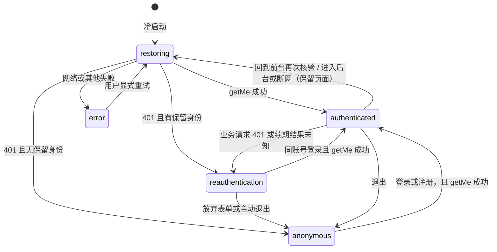

# 账号与会话模块设计

## 1 职责与边界

注册、登录、访问令牌验证、刷新、在线恢复和退出；将账号身份交给后续账本权限判断。JWT 不保存账本权限，成员授权仍在业务服务实时执行。

| 项目     | 归属                                                                                                                      |
| -------- | ------------------------------------------------------------------------------------------------------------------------- |
| 服务端   | `apps/server/src/modules/auth/`                                                                                           |
| 移动端   | `apps/mobile/src/features/auth/`、`src/lib/auth-session.ts`、`src/lib/session-token.ts`、`src/providers/AuthProvider.tsx` |
| 共享契约 | `packages/contracts/src/auth.ts` 与 `endpoints.ts`                                                                        |
| 数据     | users（注册写入）、auth_sessions、auth_refresh_tokens                                                                     |

## 2 子功能与接口

| 编号 | 操作       | 方法与路径                   | 幂等键 |
| ---- | ---------- | ---------------------------- | ------ |
| A01  | `register` | `POST /api/v1/auth/register` | 不使用 |
| A02  | `login`    | `POST /api/v1/auth/login`    | 不使用 |
| A03  | `logout`   | `POST /api/v1/auth/logout`   | 不使用 |
| A30  | `refresh`  | `POST /api/v1/auth/refresh`  | 不使用 |

注册和登录返回 `{ data: { user, accessToken, accessTokenExpiresAt, refreshToken, refreshTokenExpiresAt } }`。刷新仅接收 `{ refreshToken }`，返回相同的四个令牌字段，不要求未过期的 Access Token；退出仍使用 Access Token 的 Bearer 认证。所有响应 `Cache-Control: no-store`。注册、登录、刷新每来源 IP 每分钟最多 10 次。

`getMe`（A04）由 profile 模块提供，移动端在线恢复时调用。刷新不写业务幂等结果表，不支持通过重复刷新取回丢失的响应；客户端不得自动重试。

## 3 令牌和数据规则

- 密码使用 Argon2id。注册在同一事务写 users、auth_sessions、auth_refresh_tokens；重复邮箱返回 EMAIL_TAKEN。登录仅创建独立会话，用户名重名要求使用邮箱。
- Access Token 为 HS256 JWT，`typ=at+jwt`，`iss=tongzhang-api`，`aud=tongzhang-mobile`，`sub` 是用户 UUID，`sid` 是会话 UUID，包含 `iat` 和 `exp`。最长 15 分钟，不超过会话绝对到期时间。严格校验算法、签名、类型、签发者、受众、字段与有效期。
- `AUTH_JWT_SECRET` 为随机 32 字节的小写 hex（64 字符），只在服务端环境配置，无默认共享密钥。配置非法或缺失即拒绝启动。JWT 不包含密码、邮箱、余额或成员权限。
- Refresh Token 为随机 32 字节的 base64url 字符串；服务端只保存 SHA-256 摘要。会话从创建起固定最长 30 天，轮换不延长期限。
- `auth_sessions` 保存会话 ID、用户 ID、创建、到期和撤销时间。`auth_refresh_tokens` 保存摘要主键、会话 ID、消费与创建时间；删除会话时级联删除其摘要。
- 每次 API 请求验签后仍查会话表，校验身份与会话匹配、未过期且未撤销。在线退出提交后，后续请求携带任一旧 Access Token 都返回 401；已经进入处理的请求不承诺取消。

## 4 刷新事务与并发

1. 根据摘要找到会话，在 service 管理的事务中锁定该会话行，再读取令牌消费状态。
2. 会话不存在、到期或已撤销，返回统一 UNAUTHENTICATED（401）。
3. 如果摘要已消费，撤销所属会话。先提交事务，再返回 401，不能抛错回滚撤销。
4. 否则将旧摘要标为已消费，创建新随机令牌及摘要，签发新 Access Token，原子提交后返回新令牌对。

已消费摘要必须保留到会话清理，以识别任意旧令牌重放。并发重复刷新中至多一个请求轮换成功，另一请求检测重放并撤销会话，包括刚签发的令牌对。刷新与退出通过同一会话行锁串行化，退出成功后的最终状态始终撤销。不同登录各自使用独立会话。

密码、原始令牌不进入日志、业务缓存或幂等结果。无效和重放均不向客户端暴露数据库或摘要信息。

## 5 移动端组织与交互

`auth-session.ts` 管理内存 Access Token、并发刷新、凭据写入顺序及会话版本；`session-token.ts` 注入 SecureStore 和真实刷新请求。仅 Refresh Token 持久化。使用版本隔离，已退出或切换账号后迟到的刷新不能恢复旧令牌，旧请求的 401 也不能清除新账号。

`AuthProvider` 提供用户、恢复状态、错误及登录/注册/恢复/退出方法；App 启动在线恢复并获取 `getMe`。登录/注册 API 成功保存凭据后，Provider 再在线获取用户资料。恢复网络失败可由界面显式重试，不伪造已登录用户。默认进入欢迎、登录和注册页面；核验成功后进入受保护的账本功能。恢复状态和错误保留在根容器内，不新增全屏错误路由。

受保护的 JSON 与图片接口共享同一请求前检查，Access Token 剩余不足 30 秒时刷新，并发请求只发起一次。业务请求发送失败后不自动重试，即使返回 401 也不自动刷新并重放；401 清除会话，写表单保留内存输入及原幂等键供手动处理。

已登录进程收到真实 401 后进入 `reauthentication` 门禁，仅为保留表单实例而保留原账号的显示资料与进程内查询状态；它们不代表有效身份，也不能触摸、通过无障碍读取或绕过门禁访问业务。新凭据保存后仍须 `getMe` 核验，`session-admission.ts` 在令牌获取前及请求发送前禁止未经核验的业务 JSON/图片请求；旧会话的迟到成功响应也检查代次，不能继续后续写入。同一账号 ID 核验成功才恢复原输入、图片引用和原键，且不自动提交；其他账号先清查询内存并重建导航。用户主动放弃、退出或进程结束均丢弃原表单，不持久化业务草稿。当前原生与双端回归见 [#58/#59 最终验收](../issues58-59-final-acceptance.md)。

刷新预检查离线或明确返回 429 时保留凭据；超时、连接中断、无效响应或服务端错误导致轮换结果不确定时清除本地凭据，提示重新登录，避免重用可能已经消费的 Refresh Token。401 直接清除会话。

### 5.1 会话状态与不变量

移动端会话由三层各自负责一类问题的机制组成，不是重复防护，修改任一层前先确认它防的是哪类竞态：

| 机制                                         | 所在层                         | 防止                                                                           |
| -------------------------------------------- | ------------------------------ | ------------------------------------------------------------------------------ |
| `auth-session.ts` 的会话版本（`generation`） | 凭据存储，与界面无关           | 退出、换账号或重新登录后，迟到的刷新响应把旧令牌写回，旧请求的 401 清除新会话  |
| `controller.ts` 的 `intent`、`suspended`     | 登录状态机                     | 迟到的 `getMe`/登录结果覆盖更新的操作；断网或进入后台期间发出的核验结果被采纳  |
| `session-admission.ts`                       | 业务请求入口，镜像状态机的放行 | 核验或重新登录期间，被遮住但仍挂载的页面（含上传的延迟后续请求）继续发业务请求 |

`verify` 同时检查 `intent` 与 `sessionVersion()`：前者判断本次核验是否已被更晚的操作取代，后者判断核验期间凭据是否被替换。图片接口在令牌获取前后各检查一次放行状态，因为刷新可能耗时数秒。

只有 `authenticated` 放行业务请求（`sessionAdmission` 的值始终等于 `status === 'authenticated'`）。`restoring`、`error`、`reauthentication` 都锁住界面。

`suspended` 的语义：进入后台或收到断网事件时置位，表示**此刻之前已发出的核验作废**。`verify` 收到响应时若该标志仍置位，即使服务端返回成功也丢弃并抛 `NETWORK_UNAVAILABLE`，必须由用户显式重试，恢复联网不会自动放行。这是产品规则（见[操作手册](../app-user-guide.md)），不是技术限制。维护时必须保持：

1. `suspend()` 在任何提前返回之前置位，包括 `reauthentication` 与进行中的登录/注册。
2. `restore()` 只有在确定发起新的核验请求时才清除；复用进行中的 `restorePending` 时不得清除，否则已作废的核验会被重新采纳。
3. 恢复联网本身不触发核验、刷新或任何写操作。

这两条顺序依赖曾分别导致 `ef87306`（复用进行中的核验时被清除）与 `0e9155c`（重新登录期间断网时未置位）两个缺陷，对应回归测试在 `apps/mobile/tests/auth-controller.test.ts`。

网络状态来自 `expo-network`：`addNetworkStateListener` 接收系统推送，`isConnected` 或 `isInternetReachable` 任一为 `false` 即触发挂起。Android 通过 `registerDefaultNetworkCallback`，其 `isInternetReachable` 要求默认网络具备 `INTERNET` 与系统验证的 `VALIDATED` 能力（VPN 另要求下行带宽非零）；iOS 使用 `NWPathMonitor`，两个字段都等于路径 `satisfied`。因此连着没有外网的 Wi-Fi 时 Android 会报不可达，即使 API 在局域网内可连；这种环境未做过原生验证。`http.ts` 的发送前预检使用同一判断，其产生的 `NETWORK_UNAVAILABLE` 表示请求未发出，刷新令牌未被消耗，所以可以保留凭据；删除这层预检会使离线刷新变成“结果不确定”而清除登录，不得删除。

退出分别尝试服务端撤销与本地清理，返回 `serverRevoked` / `localCleared` 两项结果。Provider 保留跨导航的结果提示并清空用户查询缓存；远端未确认或本地删除失败时不能声称已完全退出，本地清理失败提供显式重试入口。注册/登录表单和协议仍沿用原页面与面板约定；退出/切换账号时卸载用户页面以清除表单状态。

## 6 迁移与验证

迁移已合并为单个 `0000_init`，包含 users、auth_sessions 和 auth_refresh_tokens，不含任何针对旧数据的升级语句；合并前执行过旧迁移的本地库需要重建后再迁移（步骤见[开发与部署说明](../development.md)）。发布时按既有独立迁移流程执行，API 启动不迁移。

无数据库测试覆盖 JWT 验证、客户端单次刷新、提前刷新、写请求不重发、401 清理、刷新不确定结果和迟到响应。真实 PostgreSQL 集成测试覆盖注册/登录/资料、轮换和摘要存储、重放撤销、并发刷新、刷新与退出竞态、绝对到期及不同会话隔离。原生安装与真机交互须单独验收，JavaScript 导出通过不代表真机通过。本轮 iOS 模拟器真实账号验证和截图见[移动端认证实现与验证](../mobile-auth-validation.md)。
