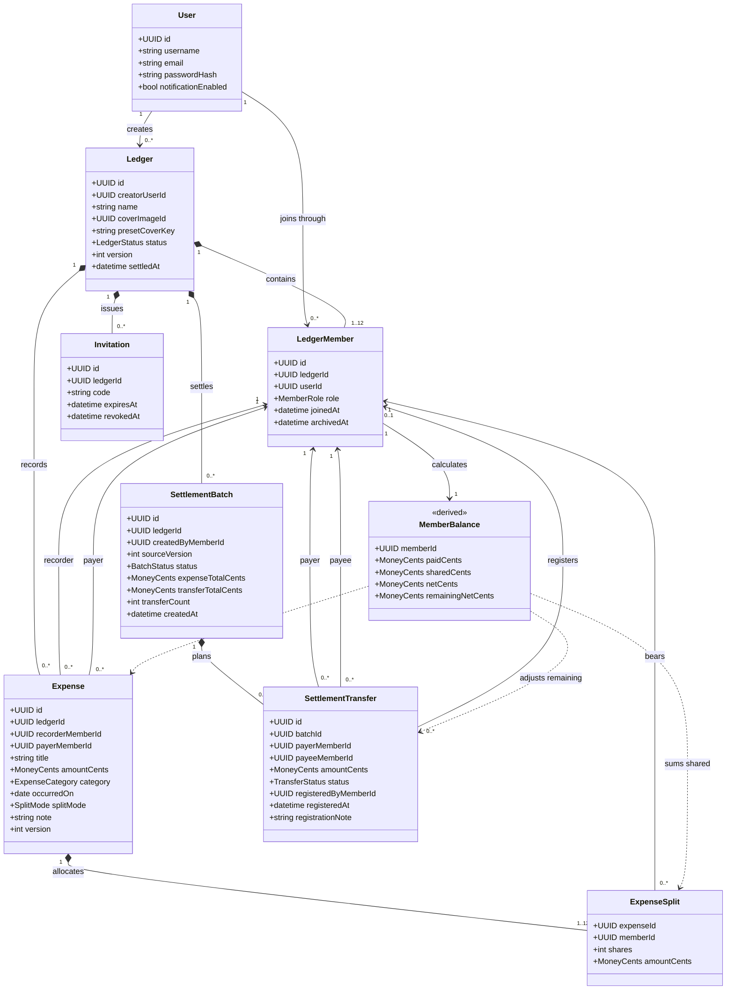
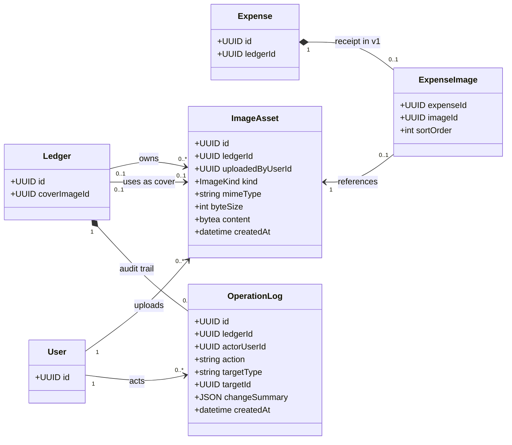

# 同账（TongZhang）原型使用说明与功能设计

版本：2026-10-12  
项目：多人共享记账与结算移动端 App  
团队：分毫不差

本文包含原型使用说明、业务类图和功能说明。第 1 章说明当前 Figma 原型如何查看与操作；第 2、3 章描述拟开发的业务模型和功能要求，不表示后端或设备能力已经实现。

## 1. 原型与使用说明

### 1.1 原型地址与查看方式

- [设计稿与 Screens](https://www.figma.com/design/tngbOd0rJkD29C7Qe2r2zh/%E5%90%8C%E8%B4%A6-TongZhang-%E2%80%94-Mobile-App-UI-UX-Design?node-id=1-3&t=vouGP3dPtU14SqEI-1)
- [可点击原型：从欢迎页开始](https://www.figma.com/proto/tngbOd0rJkD29C7Qe2r2zh?node-id=164-153&page-id=1%3A6&starting-point-node-id=164%3A153&scaling=scale-down)

`04 — Screens` 按功能展示页面、弹窗、底部面板及同页状态，本身不设置交互连线；请在 `05 — Prototype Flow` 或可点击原型中演示。Screens 按唯一编号共 73 个设计条目，包含状态示例与面板，不等于 73 个独立 App 路由。

使用说明中的“打开面板”表示覆盖在当前页面上，“原页更新”表示业务上停留在原页面。Figma 可能用不同画板模拟同页状态，开发时不应据此增加全屏路由。页面表已同时说明用途和操作，不再另设重复页面清单。

### 1.2 演示约定

| 项目       | 当前原型的演示方式                                                                   |
| ---------- | ------------------------------------------------------------------------------------ |
| 账号与表单 | 使用预设账号和消费数据。点击提交演示下一步，不执行真实注册、登录或任意表单校验。     |
| 多人加入   | 主流程预设小安、小白、小陈、小丁四人；加入流程另设分支，不能用原型实际创建三个账号。 |
| 数据计算   | 三笔消费主流程使用固定结果。分摊分支用于展示规则，不会驱动所有页面重新计算。         |
| 扫码与图片 | 点击扫描区域或图片按钮展示确认／预览；不实际调用相机、相册或上传文件。               |
| 复制与分享 | 展示复制反馈或系统分享示意，不代表已经写入系统剪贴板或发送邀请。                     |
| 异常状态   | 一部分异常只在 Screens 展示，不能通过输入任意错误值自动触发。                        |
| 通知与协议 | 通知开关展示偏好状态；未演示真实通知。协议面板为示例正文。                           |

以下逐页表中，**“展示”**表示没有对应可验证的原型操作，**“同页”**表示不应新增业务页面。右上角“更多”仅在表内注明用途时可用，其余为外观占位。普通输入框、密码眼睛、协议勾选、封面上传等未接通的控件均不应视作已实现功能。

### 1.3 账号与登录

| 编号／界面           | 用途                                   | 按钮、入口与结果                                                              |
| -------------------- | -------------------------------------- | ----------------------------------------------------------------------------- |
| 01.01 欢迎           | 产品入口                               | “开始使用”→01.03；“登录”→01.02。                                              |
| 01.02 登录           | 展示账号、密码表单                     | “登录”→02.01；“注册同账”→01.03；返回→上一画面。密码显隐为展示。               |
| 01.03 注册           | 展示用户名、邮箱、密码、确认密码及协议 | “注册并开始”→02.01；返回→上一画面。输入与勾选不执行真实提交。                 |
| 01.04 登录／凭据错误 | 原表单提示账号或密码错误               | “登录”演示重试成功→02.01；“注册同账”→01.03；返回→上一画面。错误无需独立路由。 |
| 01.05 注册／表单校验 | 展示邮箱已使用等注册错误               | “注册并开始”演示修正成功→02.01；返回→上一画面。错误保留在注册表单。           |

### 1.4 账本管理与流水

| 编号／界面             | 用途                                       | 按钮、入口与结果                                                                                                                                                                           |
| ---------------------- | ------------------------------------------ | ------------------------------------------------------------------------------------------------------------------------------------------------------------------------------------------ |
| 02.01 我的账本         | 账本状态概览和列表                         | “创建新账本”→02.02；“有邀请码？加入账本”→03.03；“鼓山一日”→02.04；底部“我的”→09.01。其他示例卡片分别演示结算中、已结清页面，当前仍复用鼓山数据。                                           |
| 02.02 创建账本         | 展示名称、预设封面及上传入口               | “创建并邀请成员”→03.01；返回→02.01。封面选项及上传为展示；选中封面保留浅底与描边。                                                                                                         |
| 02.03 暂无消费         | 创建后的空账本                             | “邀请成员一起记账”→03.01；“记第一笔”→04.01；返回→02.01。                                                                                                                                   |
| 02.04 有消费           | 查看总支出、个人已付／应摊／应收应付和流水 | 成员头像或更多→03.09；“成员余额”→06.01；“支出统计”→06.03；“预览结算”→07.01；“筛选”→02.08；消费行→04.02；“记一笔”→04.01；返回→02.01。                                                       |
| 02.05 删除完成轻提示   | 删除后刷新原流水                           | 演示删除食堂午餐后总支出为 ¥180，提示“已删除，余额已更新”；其余入口同02.04。后续余额／统计仍复用完整账本示例。                                                                             |
| 02.06 结算中只读       | 查看冻结消费                               | “成员余额”→06.02；“支出统计”→06.03；“结算进度／查看结算进度”→07.04或07.05示例；食堂午餐→04.04；返回→02.01。无新增、编辑、删除入口。                                                        |
| 02.07 记账完成轻提示   | 保存成功后的流水反馈                       | 业务上返回02.04并提示已记账；主演示通过保存后 1／2／3 笔流水快照展示结果，不另设成功页。                                                                                                   |
| 02.08 流水筛选底部面板 | 设置日期、付款人、类别                     | “餐饮”／“住宿”切换示例条件；“应用筛选”→02.09／02.10，未选条件→02.04；“重置筛选”恢复初始面板；关闭或点遮罩→原列表。日期范围入口打开日期面板，但当前仅演示日期单选；付款人及其他类别为展示。 |
| 02.09 流水已筛选       | 展示餐饮筛选结果                           | “筛选·1”→02.08；食堂午餐→04.02；其他工具入口同02.04。账本摘要仍展示整个账本金额。                                                                                                          |
| 02.10 流水无匹配结果   | 展示住宿类别无消费                         | “清除筛选”→02.04；“筛选·1”→02.08；其他工具入口同02.04。                                                                                                                                    |

主流程的 1 笔／2 笔流水快照分别为 ¥120／¥240，不另编 Screens 页面号。按“记一笔”依次进入门票、车费示例。三笔保存完成后再查看余额、统计和结算，避免与固定的 ¥300 示例混用。

### 1.5 成员与邀请

| 编号／界面           | 用途                           | 按钮、入口与结果                                                                                                                    |
| -------------------- | ------------------------------ | ----------------------------------------------------------------------------------------------------------------------------------- |
| 03.01 邀请成员       | 展示账本、6位邀请码、二维码    | “复制邀请码”→03.02轻提示；“分享邀请”直接打开系统分享示意；“进入账本”→02.03（创建场景）；返回→02.01。已有账本场景的返回按钮回02.04。 |
| 03.02 复制轻提示     | 反馈邀请码已复制               | 提示覆盖原邀请页，可关闭；不增加业务跳转。                                                                                          |
| 03.03 输入邀请码加入 | 展示6位码输入                  | “在 App 内扫码”→03.04；“查看账本”→03.05；返回→02.01。                                                                               |
| 03.04 应用内扫码     | 展示扫描区域                   | 点击扫描区域→03.05；“使用邀请码加入”及返回→03.03。                                                                                  |
| 03.05 加入确认面板   | 核对账本、创建者和成员数       | “加入鼓山一日”→02.04；“暂不加入”或遮罩→原加入页面。                                                                                 |
| 03.06 邀请码错误     | 原输入页显示“邀请码不正确”     | Screens 状态展示。开发时“查看账本”重试，“扫码”切换03.04，返回不清空当前输入。                                                       |
| 03.07 邀请码过期     | 原输入页提示联系创建者获取新码 | Screens 状态展示。更换邀请码后重试；不应跳转独立错误页。                                                                            |
| 03.08 成员已满       | 原输入页显示12／12人           | Screens 状态展示。不得加入；可返回或更换邀请码。                                                                                    |
| 03.09 成员底部面板   | 查看成员及创建者标识           | “邀请成员”→03.01已有账本场景；“重置邀请码”→03.10；关闭或遮罩→原账本。                                                               |
| 03.10 重置邀请确认   | 说明旧码和旧二维码失效         | “确认重置”→展示新码的03.01；“取消”／关闭→原页。重置后“进入账本”→02.04。                                                             |

系统分享示意中，“信息”“隔空投送”“取消”关闭面板；“复制邀请码”显示复制提示，不再先经过自定义分享选择页。已有账本邀请分支的“进入账本”仍复用空账本目标，演示已有流水时请用左上返回。

### 1.6 消费记录

| 编号／界面           | 用途                                                 | 按钮、入口与结果                                                                                                                                     |
| -------------------- | ---------------------------------------------------- | ---------------------------------------------------------------------------------------------------------------------------------------------------- |
| 04.01 新增消费       | 金额、名称、类别、付款人、日期、分摊、备注、收据表单 | 类别→04.07；付款人→04.08；日期→04.09；“参与分摊”和“分摊方式”均→05.01；相册、拍摄、收据预览→收据预览覆盖层；“保存消费”→02.04对应笔数快照；返回→上页。 |
| 04.02 可编辑消费详情 | 查看付款人、记录人、日期、分摊、备注、收据           | “查看收据”→预览覆盖层；“编辑消费”→04.10；“删除这笔消费”→04.03；返回→来源流水。门票、车费使用详情快照，编辑／删除仍复用午餐示例。                     |
| 04.03 删除确认面板   | 避免误删                                             | “确认删除”→02.05；“保留消费”或遮罩→原详情。                                                                                                          |
| 04.04 结算中只读详情 | 查看冻结消费                                         | 返回→02.06；“结算中·只读”是状态说明，不是提交按钮。                                                                                                  |
| 04.05 已结清只读详情 | 查看历史消费                                         | 返回→已结清账本的历史流水；“已结清·只读”不可操作。                                                                                                   |
| 04.06 保存失败       | 原表单保留输入并给出重试                             | “重试保存”→1笔流水快照；返回→上一画面。不是独立错误路由。                                                                                            |
| 04.07 类别选择面板   | 餐饮、交通、门票、住宿、购物、其他                   | 点击类别更新原表单并关闭；关闭／遮罩不切换业务页。                                                                                                   |
| 04.08 付款人选择面板 | 从账本成员中选择垫付者                               | 点击成员更新姓名和头像标识并关闭；关闭／遮罩取消选择。                                                                                               |
| 04.09 日期选择面板   | 选择消费日期                                         | 点击日期更新原表单并关闭；“确定日期”关闭面板；关闭／遮罩返回原表单。当前仅预设月份。                                                                 |
| 04.10 编辑消费       | 回填已有消费                                         | 字段入口同04.01；“保存修改”→02.04；返回→04.11。当前示例回填食堂午餐。                                                                                |
| 04.11 未保存修改确认 | 避免意外丢失编辑                                     | “继续编辑”／关闭→原表单；“放弃修改”→02.04。                                                                                                          |

收据覆盖层展示示例收据，“关闭”或关闭图标返回来源。移除、重新选图和图片上传失败属于开发要求，当前没有完整可点击模拟。

### 1.7 分摊设置

| 编号／界面     | 用途                                   | 按钮、入口与结果                                                                       |
| -------------- | -------------------------------------- | -------------------------------------------------------------------------------------- |
| 05.01 全部参与 | 人均分摊及逐人预览                     | “按份”→05.03；“按金额”→05.04；点击小丁→05.02；“完成”更新分摊摘要并回04.01；返回→来源。 |
| 05.02 部分参与 | 排除未参与消费的成员                   | 点击小丁重新参与→05.01；方式标签切换05.01／05.03／05.04；“完成”回04.01。               |
| 05.03 按份     | 展示2份／1份等比例及应摊金额           | 人均→05.01；按金额→05.04；“完成”回04.01；份数为预设示例。                              |
| 05.04 按金额   | 展示每人指定金额、合计                 | 人均→05.01；按份→05.03；“完成”回04.01；金额为预设示例。                                |
| 05.05 未选错误 | 0人参与时提示至少选择1人               | Screens 状态展示；“完成”不可提交，选择成员后才可继续。                                 |
| 05.06 尾差示例 | 展示100元三人均分为33.34／33.33／33.33 | 规则展示，不计入鼓山账本；“规则示例·不保存”不创建消费。                                |
| 05.07 合计不符 | 展示120元只分配110元的错误             | “完成”禁用；方式标签可切换到有效示例；返回→来源。                                      |

“参与分摊”和“分摊方式”共用这套界面，预览就在设置页内。门票、车费各有对应快照，“完成”返回各自的记账表单。通用分摊分支目前固定返回新增午餐表单，不覆盖任意编辑来源；开发时必须返回实际来源并保留输入。

### 1.8 成员余额与统计

| 编号／界面             | 用途                                   | 按钮、入口与结果                                                                    |
| ---------------------- | -------------------------------------- | ----------------------------------------------------------------------------------- |
| 06.01 成员余额／进行中 | 总花费、应收应付、成员已付／应摊／净额 | “预览结算”→07.01；返回→来源账本。成员行是信息展示。                                 |
| 06.02 成员余额／结算中 | 查看冻结账单对应的收付关系             | “查看结算进度”→07.04或07.05示例；返回→02.06。当前余额示例未随所有还款状态动态重算。 |
| 06.03 支出统计         | 总支出、类别环形图、成员已付／应摊对比 | 返回→来源账本。图表与图例为展示，不提供图表钻取。                                   |

当前“查看结算进度”的条件连线仅覆盖已登记30元和60元两个结果；尚未登记、全部已还从冻结账本返回时不能完整恢复状态。主演示应在结算进度内连续登记两笔；开发要求仍是读取并恢复真实进度。

### 1.9 结算与登记已还

| 编号／界面               | 用途                                         | 按钮、入口与结果                                                                       |
| ------------------------ | -------------------------------------------- | -------------------------------------------------------------------------------------- |
| 07.01 结算预览           | 白底摘要展示待转账总额、账本总支出和转账笔数 | “复制完整方案”→07.12；“正式发起结算”→07.02；返回→02.04。预览不冻结账本。               |
| 07.02 冻结确认面板       | 确认后不可继续改消费                         | “确认冻结并结算”→07.03；“返回检查”或遮罩→07.01。                                       |
| 07.03 尚未登记           | 展示2笔待登记转账                            | 30元／60元卡片的“登记已还”分别→07.06／07.07；复制单笔／完整方案→复制提示；返回→02.06。 |
| 07.04 已登记30元         | 展示剩余60元待登记                           | 60元“登记已还”→07.07；复制按钮→提示；返回→02.06。已登记的30元不能重复登记。            |
| 07.05 已登记60元         | 展示剩余30元待登记                           | 30元“登记已还”→07.06；复制按钮→提示；返回→02.06。                                      |
| 07.06 登记30元面板       | 核对小陈→小安、¥30，可填写说明               | “确认登记已还”→07.04；若60元已还则→07.09；“取消”或遮罩→原进度。                        |
| 07.07 登记60元面板       | 核对小丁→小白、¥60，可填写说明               | “确认登记已还”→07.05；若30元已还则→07.09；“取消”或遮罩→原进度。                        |
| 07.08 单笔复制轻提示     | 反馈转账信息已复制                           | 保持当前结算进度，不新增路由。当前可点击原型与完整方案共用提示覆盖层。                 |
| 07.09 全部已还待结清     | 展示全部登记完成，等待创建者结清             | “确认整本结清”→07.10；复制→提示；返回→02.06。                                          |
| 07.10 整本结清确认       | 再次核对后进入只读                           | “确认结清”→08.01；“返回核对”／关闭／遮罩→原页。                                        |
| 07.11 无需转账           | 展示待转账¥0、0笔                            | “确认整本结清”→07.10零转账分支→08.01零转账结果；返回→来源。                            |
| 07.12 完整方案复制轻提示 | 反馈整份方案已复制                           | 覆盖在来源页面，可关闭，不切换业务页。                                                 |

“已还”仅是人工登记。原型和产品均不代表银行、微信或支付宝验证到账。

### 1.10 结清、归档与历史

| 编号／界面               | 用途                                                   | 按钮、入口与结果                                                                       |
| ------------------------ | ------------------------------------------------------ | -------------------------------------------------------------------------------------- |
| 08.01 账本已结清         | 总支出、成员数和完整结算记录；登记时间直接显示在卡片内 | “历史账单”→已结清历史流水；“归档账本”→08.02；返回→已结清列表快照。结算记录标题无跳转。 |
| 08.02 归档确认面板       | 说明移出当前列表但保留历史                             | “确认归档”→08.03；“暂不归档”或遮罩→08.01。                                             |
| 08.03 原列表／已归档提示 | 返回原账本列表并提示归档成功                           | “查看历史账本”→08.04；“创建新账本”→02.02。原型底部导航目前复用回02.01的入口。          |
| 08.04 历史账本           | 展示归档账本                                           | “鼓山一日”→08.01；返回或“返回个人中心”→09.01。                                         |

08.05 历史结算记录已删除，内容合并至08.01。已结清历史流水的“查看结算记录”也返回08.01。该流水中消费行当前共用食堂午餐只读示例，开发时应显示所点消费。

### 1.11 个人中心与应用设置

| 编号／界面         | 用途                           | 按钮、入口与结果                                                                                                                                       |
| ------------------ | ------------------------------ | ------------------------------------------------------------------------------------------------------------------------------------------------------ |
| 09.01 个人中心     | 账户资料、账本与设置入口       | “我的账本”→02.01；“历史记录”→08.04；“账户信息”→09.02；“设置”→09.03；“关于同账”→09.04；“退出登录”→09.07；底部账本→02.01。顶部数量区域共用历史账本热点。 |
| 09.02 账户信息     | 展示用户名与邮箱               | “保存资料”显示成功提示，停留当前页；返回→09.01。没有真实修改账号。                                                                                     |
| 09.03 应用设置     | 通知开关、固定人民币、协议入口 | 通知开关切换开／关快照；“隐私政策”→09.05；“用户协议”→09.06；返回→09.01。“人民币 CNY”不可选择，没有保存设置按钮。                                       |
| 09.04 关于同账面板 | 产品与版本介绍                 | 关闭或遮罩→来源页。                                                                                                                                    |
| 09.05 隐私政策面板 | 阅读示例隐私政策               | “关闭”、关闭图标或遮罩→来源页。                                                                                                                        |
| 09.06 用户协议面板 | 阅读示例用户协议               | “关闭”、关闭图标或遮罩→来源页。                                                                                                                        |
| 09.07 退出登录确认 | 避免误退出                     | “退出登录”→01.02；“取消”、关闭或遮罩→09.01。                                                                                                           |

### 1.12 通用状态与适配

| 编号／界面           | 用途                           | 按钮、入口与结果                                                                       |
| -------------------- | ------------------------------ | -------------------------------------------------------------------------------------- |
| 10.01 首次加载       | 账本列表内容区的骨架状态       | Screens 展示，不是独立页面；开发时加载成功更新02.01，失败更新10.02。                   |
| 10.02 加载失败       | 原列表显示失败原因和重试       | “重试加载”→02.01；不要求用户先退出当前任务。                                           |
| 10.03 长文本适配     | 验证长账本名、消费名和完整金额 | Screens 展示；“查看账本”是设计示例，当前未接入演示。                                   |
| 10.04 状态与规则参考 | 设计评审索引                   | “查看”“同页重试”“内容骨架”“返回我的账本”作为说明性索引展示，不属于产品页面或正式导航。 |

### 1.13 完整操作演示：鼓山一日

使用主原型入口开始，以小安为创建者。邀请环节展示邀请码和加入分支，主流程随后使用已预设的四人账本。

| 步骤 | 点击／查看                                                       | 到达的页面或结果                                           |
| ---- | ---------------------------------------------------------------- | ---------------------------------------------------------- |
| 1    | 欢迎页点“开始使用”，注册页点“注册并开始”                         | 02.01我的账本。                                            |
| 2    | 点“创建新账本”，查看名称“鼓山一日”和山野封面，点“创建并邀请成员” | 03.01邀请成员。                                            |
| 3    | 点“复制邀请码”查看反馈；关闭提示后点“分享邀请”查看示意并取消     | 保持邀请页；实际开发由三名成员分别登录并加入。             |
| 4    | 点“进入账本”→“记第一笔”                                          | 空账本进入午餐表单。                                       |
| 5    | 食堂午餐¥120，小安付款；打开分摊，四人人均，点“完成”→“保存消费”  | 流水1笔，总支出¥120。                                      |
| 6    | 点“记一笔”，查看鼓山门票¥120、小白付款、四人人均；保存           | 流水2笔，总支出¥240。                                      |
| 7    | 再点“记一笔”，查看往返车费¥60、小陈付款，仅小安和小陈分摊；保存  | 流水3笔，总支出¥300。                                      |
| 8    | 点“成员余额”，核对下表；返回后可查看“支出统计”                   | 四人净额合计为0，餐饮40%、门票40%、交通20%。               |
| 9    | 返回账本点“预览结算”                                             | 待转账¥90、2笔：小陈→小安¥30，小丁→小白¥60。               |
| 10   | 点“复制完整方案”                                                 | 出现复制反馈。老师要求的“建账本→记一笔→看谁转给谁”已完成。 |
| 11   | 点“正式发起结算”→“确认冻结并结算”                                | 07.03；账本进入结算中，消费只读。                          |
| 12   | 30元卡片点“登记已还”→“确认登记已还”                              | 07.04，剩余60元。                                          |
| 13   | 60元卡片点“登记已还”→“确认登记已还”                              | 07.09，全部已还但尚未整本结清。                            |
| 14   | 点“确认整本结清”→“确认结清”                                      | 08.01；两笔记录显示登记时间。                              |
| 15   | 点“归档账本”→“确认归档”                                          | 返回原列表并提示已归档，不直接跳历史页。                   |
| 16   | 点提示中的“查看历史账本”，再点鼓山一日                           | 可重新查看已结清结果和历史记录。                           |

示例日期为2026年10月10日；下表展示单位为元，实际存储统一为整数分。

| 消费     | 付款人 |   金额 | 分摊成员               | 每人应摊 |
| -------- | ------ | -----: | ---------------------- | -------: |
| 食堂午餐 | 小安   | 120.00 | 小安、小白、小陈、小丁 |    30.00 |
| 鼓山门票 | 小白   | 120.00 | 小安、小白、小陈、小丁 |    30.00 |
| 往返车费 | 小陈   |  60.00 | 小安、小陈             |    30.00 |

| 成员 |   已付 |  应摊 |   净额 | 结算动作     |
| ---- | -----: | ----: | -----: | ------------ |
| 小安 | 120.00 | 90.00 | +30.00 | 收小陈30元   |
| 小白 | 120.00 | 60.00 | +60.00 | 收小丁60元   |
| 小陈 |  60.00 | 90.00 | −30.00 | 向小安付30元 |
| 小丁 |   0.00 | 60.00 | −60.00 | 向小白付60元 |

两笔转账是这组数据的计算结果，不是固定业务规则。120元应存为12000分；本例总支出30000分，待转账总额9000分。

### 1.14 分支演示入口

| 分支         | 入口与操作                                                                                                                                                                                                          |
| ------------ | ------------------------------------------------------------------------------------------------------------------------------------------------------------------------------------------------------------------- |
| 加入账本     | [打开加入演示](https://www.figma.com/proto/tngbOd0rJkD29C7Qe2r2zh?node-id=164-614&page-id=1%3A6&starting-point-node-id=164%3A614&scaling=scale-down)；查看账本→确认加入，或扫码→点击扫描框→确认加入。               |
| 三种分摊     | [打开分摊演示](https://www.figma.com/proto/tngbOd0rJkD29C7Qe2r2zh?node-id=164-1050&page-id=1%3A6&starting-point-node-id=164%3A1050&scaling=scale-down)；依次查看部分参与、按份、按金额。                            |
| 筛选与编辑   | [打开流水演示](https://www.figma.com/proto/tngbOd0rJkD29C7Qe2r2zh?node-id=164-1468&page-id=1%3A6&starting-point-node-id=164%3A1468&scaling=scale-down)；筛选餐饮查看结果，筛选住宿查看无结果；食堂午餐→编辑或删除。 |
| 反向登记顺序 | [打开结算进度](https://www.figma.com/proto/tngbOd0rJkD29C7Qe2r2zh?node-id=164-1873&page-id=1%3A6&starting-point-node-id=164%3A1873&scaling=scale-down)；先登记60元，再登记30元。                                    |
| 零转账       | [打开无需转账示例](https://www.figma.com/proto/tngbOd0rJkD29C7Qe2r2zh?node-id=164-3115&page-id=1%3A6&starting-point-node-id=164%3A3115&scaling=scale-down)；确认整本结清。                                          |
| 个人设置     | [打开个人中心](https://www.figma.com/proto/tngbOd0rJkD29C7Qe2r2zh?node-id=164-2556&page-id=1%3A6&starting-point-node-id=164%3A2556&scaling=scale-down)；设置→切换通知→查看协议→关闭。                               |
| 网络重试     | [打开加载失败示例](https://www.figma.com/proto/tngbOd0rJkD29C7Qe2r2zh?node-id=164-2879&page-id=1%3A6&starting-point-node-id=164%3A2879&scaling=scale-down)；点“重试加载”回账本列表。                                |

## 2. 业务类图与数据约定

### 2.1 模型范围

客户端采用 React Native、Expo、TypeScript，服务端采用 Fastify、TypeScript，数据库采用 PostgreSQL。以下是业务类设计，不是现有代码反向生成的类图。类中的ID统一为UUID，时间统一保存带时区时间；消费日期保存日期值。

**所有金额以整数“分”存储和计算。** 类图中的 `MoneyCents` 对应 PostgreSQL `BIGINT`、服务端 `bigint`；JSON接口以十进制整数字符串传输，如 `"12000"`，客户端格式化为 `¥120.00`。份数、人数、文件字节数不是金额。

### 2.2 核心业务类图

组合关系表示业务归属，不意味着允许删除账本时级联抹除历史。付款人、记录人、分摊人和登记人是不同角色，必须分别保存。

### 2.3 图片及审计类图

图片放独立表的 `bytea` 字段，不将 Base64 文本塞入消费表。创建账本前的封面允许临时归属为空，创建成功后绑定账本；未关联图片定时清理。业务读取必须校验账本成员权限。操作日志仅用于审计，不等于首版已提供“动态”页面。

### 2.4 类职责与约束

| 类                       | 职责及主要约束                                                                                                      |
| ------------------------ | ------------------------------------------------------------------------------------------------------------------- |
| User                     | 保存身份与偏好；用户名、邮箱唯一；只保存密码哈希，不保存明文密码。                                                  |
| Ledger                   | 保存名称、封面、创建者、状态及数据版本；状态为进行中、结算中、已结清；创建者必须同时有成员关系。                    |
| LedgerMember             | 连接用户与账本；`(ledgerId,userId)`唯一；每本含创建者最多12人；角色为创建者或成员。                                 |
| Invitation               | 同时供手输和扫码使用；有效码唯一；默认有效7天；重置撤销旧记录并生成新记录。                                         |
| Expense                  | 每笔只有一个付款人；记录人由登录身份确定；金额大于0；付款人可以不参与分摊。                                         |
| ExpenseSplit             | `(expenseId,memberId)`唯一；参与者至少1人；金额非负，合计必须等于消费金额；按份时`shares`为正整数，其他方式可为空。 |
| SettlementBatch          | 保存正式结算快照；同一账本至多一个有效批次；预览不写正式批次；全零净额批次允许0笔。                                 |
| SettlementTransfer       | 金额大于0，付款人与收款人不同；状态为待登记、已登记；登记后保存登记人、时间、说明。                                 |
| MemberBalance            | 查询时派生，不作为消费源数据；净额可为负；登记还款只影响剩余净额。                                                  |
| ImageAsset／ExpenseImage | 封面与收据共用图片存储；首版每笔最多1张收据；限制图片大小、类型及访问权限。                                         |
| OperationLog             | 记录消费变更、邀请重置、结算、已还登记、结清、归档；不记录密码和完整图片二进制。                                    |

所有参与同一笔消费或结算转账的成员必须属于同一账本；除外键外，服务端事务需检查这项跨实体约束。可空字段包括预设／上传封面中的非选项、结清时间、归档时间、撤销时间、登记前的登记信息。

### 2.5 状态、金额与事务规则

| 规则               | 设计要求                                                                                                                          |
| ------------------ | --------------------------------------------------------------------------------------------------------------------------------- |
| 账本状态           | `ACTIVE → SETTLING → SETTLED`。归档是列表整理标记，不增加第四种财务状态。                                                         |
| 本文补充的归档约定 | 采用个人归档，保存于`LedgerMember.archivedAt`，仅将账本移出操作者的当前列表；只允许归档已结清账本。原型未演示不同成员的归档差异。 |
| 分摊模式           | `EQUAL`人均、`SHARES`按份、`AMOUNT`按金额。保存每人的最终分值。                                                                   |
| 类别               | 餐饮、交通、门票、住宿、购物、其他。                                                                                              |
| 消费净额           | `netCents = paidCents − sharedCents`；全部成员净额合计为0。                                                                       |
| 剩余净额           | `remainingNetCents = netCents + 已登记对外还款 − 已登记收到还款`；正数应收，负数应付。                                            |
| 转账与消费         | 还款不增加总支出，不修改消费类别占比和原始分摊。                                                                                  |
| 分摊余分           | 人均／按份使用最大余数法；余数相同时按固定成员ID顺序处理，合计严格守恒。                                                          |
| 保存事务           | 消费和分摊明细一起成功或一起失败；不能只保存消费、漏保存分摊。                                                                    |
| 正式结算事务       | 核对账本版本、冻结消费、生成并保存批次及转账、更新状态必须一致完成。                                                              |
| 重复请求           | 新增消费、正式结算、登记已还携带请求标识；相同请求返回同一结果，不重复记账或还款。                                                |
| 结清条件           | 所有转账已登记且所有剩余净额为0；创建者确认后转已结清。                                                                           |

最少笔数方案采用净额汇总与状态压缩动态规划。去除零净额成员后，设人数为`n`，最多可分成`k`个互不重叠的零和组，最少笔数为`n−k`；每组内匹配应付与应收。首版限制12人，允许组内任意应付款人向应收款人结算，不设置指定收款对象等额外限制。零净额返回空方案，不能生成0元转账。

## 3. 功能说明

下表统一按“操作—输入—输出—账本变化—错误反馈”描述。错误反馈是开发要求；不意味着当前原型会根据输入自动触发全部错误。

### 3.1 账号与个人设置

| 功能／操作           | 输入                                   | 输出                             | 账本或账户变化           | 输入错误／失败反馈                                                             |
| -------------------- | -------------------------------------- | -------------------------------- | ------------------------ | ------------------------------------------------------------------------------ |
| 注册                 | 用户名、邮箱、密码、确认密码、协议勾选 | 用户身份和登录会话，进入账本列表 | 新建用户，不创建账本     | 必填、邮箱格式、重复账号、密码不足8位、不一致、未同意协议在原表单提示。        |
| 登录                 | 邮箱或用户名、密码                     | 登录会话和参与账本列表           | 不改账本                 | 凭据错误就地提示；不跳错误页；网络错误提供重试。                               |
| 修改资料             | 新用户名；邮箱显示                     | 更新后的账户资料                 | 只更新本人资料           | 空值、重名在字段旁提示。本文采用邮箱只读约定，暂不提供换绑流程。               |
| 切换通知偏好         | 开／关                                 | 当前开关状态                     | 更新本人偏好，不改账本   | 保存失败恢复原值并提示；系统权限未授权时说明原因。具体通知事件不纳入本次范围。 |
| 查看货币、协议、关于 | 所点入口                               | 人民币固定信息或阅读面板         | 无变化                   | 加载失败在原面板提供重试；没有保存设置按钮。                                   |
| 退出登录             | 二次确认                               | 返回登录入口                     | 清除本机会话，不删除账本 | 取消关闭面板，保持登录。                                                       |

### 3.2 账本与成员

| 功能／操作           | 输入                     | 输出                                   | 账本变化                                     | 输入错误／失败反馈                                             |
| -------------------- | ------------------------ | -------------------------------------- | -------------------------------------------- | -------------------------------------------------------------- |
| 创建账本             | 名称、预设封面或上传图片 | 新账本及邀请信息                       | 新建进行中账本；创建者成为第1名成员；总支出0 | 名称为空、图片无效在原表单提示；提交失败保留输入。             |
| 查看账本列表         | 当前登录用户             | 未被本人归档的账本及状态概览           | 无变化                                       | 内容区加载；失败原页重试。                                     |
| 查看账本详情         | 账本ID                   | 成员、总支出、个人金额、流水及可用操作 | 无变化                                       | 非成员拒绝访问；账本状态变化时刷新并收起不可用操作。           |
| 查看成员             | 账本ID                   | 成员数、名单、创建者及本人标识         | 无变化                                       | 无权限或网络失败在原页提示。                                   |
| 查看／复制／分享邀请 | 账本ID、当前有效邀请码   | 6位码、二维码、邀请文案或系统分享      | 无变化                                       | 非创建者无邀请管理权限；系统操作失败就地提示。                 |
| 查询邀请             | 6位邀请码或扫码结果      | 账本名称、创建者、人数确认面板         | 尚不加入                                     | 长度或格式错误、无效码、过期、已满、不接受加入，原输入页提示。 |
| 确认加入             | 有效邀请、登录用户确认   | 加入成功并打开账本                     | 新增成员关系；旧消费分摊不变                 | 事务内再次检查状态、人数；重复加入直接进入，不产生重复成员。   |
| 重置邀请             | 创建者确认               | 新码与新二维码                         | 旧邀请撤销；账本消费不变                     | 权限不足或非进行中拒绝；失败保留旧有效码，不显示假成功。       |

### 3.3 消费记录与图片

| 功能／操作             | 输入                                                    | 输出                   | 账本变化                                                   | 输入错误／失败反馈                                                         |
| ---------------------- | ------------------------------------------------------- | ---------------------- | ---------------------------------------------------------- | -------------------------------------------------------------------------- |
| 新增消费               | 名称、金额、类别、付款人、日期、分摊；可选备注、1张收据 | 消费ID及更新后的流水   | 总支出增加；付款人已付增加；参与人应摊增加；余额与统计刷新 | 金额非正、超过两位小数、缺字段、无参与人、合计不符禁止保存，错误就地展示。 |
| 选择类别／付款人／日期 | 面板选项                                                | 更新当前表单字段       | 保存前不改账本                                             | 付款人非本账本成员、日期无效提示并阻止提交。                               |
| 编辑消费               | 原消费ID、版本、新字段及分摊                            | 更新后的消费详情       | 原金额及分摊贡献被新数据替换，不重复累加                   | 无权限、已冻结／结清、版本过期拒绝；保留输入并提示刷新核对。               |
| 删除消费               | 消费ID、确认                                            | 返回流水并提示删除完成 | 从有效消费汇总中扣除金额与分摊，刷新余额及统计             | 无权限、已冻结／结清不能删除；失败不从列表移除。                           |
| 选择／拍摄收据         | 图片文件                                                | 预览图与上传后的图片ID | 与消费保存成功后建立关联；不增加支出                       | 权限拒绝可改用相册；文件无效、超限、上传失败可移除或重试。                 |
| 查看收据               | 图片ID                                                  | 图片预览               | 无变化                                                     | 无权限拒绝；读取失败占位并允许重试。                                       |
| 放弃编辑               | 返回操作及确认                                          | 继续编辑或回流水       | 未提交数据不写入账本                                       | 取消退出保留当前输入；不生成离线草稿。                                     |

图片首版支持一张；建议压缩后不超过1MB，服务端同时检查实际类型、字节数及像素尺寸。业务金额上限与图片最终限制由接口统一配置，超限提示应明确显示限制值。

### 3.4 三种分摊

| 功能／操作 | 输入                   | 输出                       | 账本变化                     | 输入错误／失败反馈                                                       |
| ---------- | ---------------------- | -------------------------- | ---------------------------- | ------------------------------------------------------------------------ |
| 选择参与人 | 当前成员勾选集合       | 参与人数和逐人应摊预览     | 设置阶段无写入               | 0人参与提示“至少选择1位参与成员”，禁用完成。                             |
| 人均       | 金额与参与人           | 整数分均分结果             | 随消费一并保存               | 余分按固定规则分配；100元三人为33.34、33.33、33.33，不能丢失或多出金额。 |
| 按份       | 每名参与者的正整数份数 | 按份数比例分配结果         | 随消费一并保存               | 份数为空、非整数或不大于0，在对应成员行提示。                            |
| 按金额     | 每名参与者的非负金额   | 已分配合计、差额、逐人应摊 | 随消费一并保存               | 合计不足或超出均禁止完成，显示差额；例如120元分了110元，提示还差10元。   |
| 完成分摊   | 合法的参与人和金额     | 返回原消费表单，更新摘要   | 尚未记账，直到保存消费才写入 | 失败保持设置页；不另开重复预览页。                                       |

分摊允许付款人不在参与者中。未选择的成员本笔应摊为0；按金额模式已选择成员可以承担0分，但全部合计必须等于正的消费总额。

### 3.5 查询、余额与统计

| 功能／操作           | 输入                   | 输出                                       | 账本变化                       | 输入错误／失败反馈                                          |
| -------------------- | ---------------------- | ------------------------------------------ | ------------------------------ | ----------------------------------------------------------- |
| 浏览流水             | 账本ID                 | 消费日期倒序列表                           | 无变化                         | 加载失败原页重试；无消费展示空账本。                        |
| 组合筛选             | 日期范围、付款人、类别 | 符合全部条件的流水与筛选标记               | 无变化，账本总支出不随筛选改变 | 起始晚于结束在面板提示；无匹配结果提供清除筛选。            |
| 清除筛选             | 清除操作               | 全部有效消费列表                           | 无变化                         | 请求失败保留条件并提示重试。                                |
| 查看消费详情         | 消费ID                 | 支出、付款人、记录人、逐人分摊、备注、图片 | 无变化                         | 不存在或无权限提示；冻结／结清时只读。                      |
| 查看成员余额         | 账本ID、已登记转账     | 已付、应摊、消费净额、剩余净额             | 无变化                         | 计算失败不显示伪造0；重试获取。应收／应付同时给文字与颜色。 |
| 查看总支出及类别统计 | 全部有效消费           | 总金额、分类金额及占比                     | 无变化                         | 总额为0展示暂无数据，不计算除以0；百分比仅用于显示。        |
| 查看成员对比         | 消费与分摊明细         | 各成员已付／应摊图表和数值                 | 无变化                         | 图例与图形颜色一一对应；还款不重复计入消费。                |

### 3.6 结算与还款登记

| 功能／操作   | 输入                     | 输出                                         | 账本变化                                     | 输入错误／失败反馈                                                         |
| ------------ | ------------------------ | -------------------------------------------- | -------------------------------------------- | -------------------------------------------------------------------------- |
| 预览结算     | 当前账本版本与有效消费   | 最少转账方案、笔数、待转账总额               | 无状态变化，可继续改账                       | 非成员拒绝；计算失败提示重试，不能用错误结果继续发起。                     |
| 正式发起结算 | 创建者确认、预览对应版本 | 保存后的正式方案                             | 进行中→结算中；冻结消费和成员变更            | 预览过期提示重新核对；无权限拒绝；重复请求不生成新有效批次。               |
| 复制完整方案 | 当前预览或正式批次       | 账本名、笔数、总转账额、双方和金额组成的文本 | 无变化                                       | 复制失败同页提示；不能将失败显示为复制成功。                               |
| 复制单笔     | 转账ID                   | 本笔付款人、收款人、金额                     | 无变化                                       | 找不到转账或无权限时拒绝。                                                 |
| 登记已还     | 转账ID、确认、可选说明   | 本笔已登记，显示登记人和时间                 | 更新转账状态及剩余净额；不改总支出、原始应摊 | 仅付款人或创建者可登记；已登记重复请求返回原结果；失败停留原进度并可重试。 |
| 查看进度     | 正式批次                 | 已登记笔数、总笔数、剩余金额、明细           | 无变化                                       | 读取失败原页重试；再次打开读取保存方案，不重新分配收款对象。               |
| 零净额结算   | 全部成员净额为0          | 0笔、0元方案                                 | 创建者确认后直接已结清                       | 不生成0元转账；非创建者不能整本结清。                                      |

登记按方案整笔完成，不支持分次偿还。同账不接入真实支付，也不自动判断对方是否收到钱。

### 3.7 结清、归档与历史

| 功能／操作   | 输入                     | 输出                            | 账本变化                                   | 输入错误／失败反馈                                  |
| ------------ | ------------------------ | ------------------------------- | ------------------------------------------ | --------------------------------------------------- |
| 整本结清     | 创建者确认               | 已结清结果及转账记录            | 结算中→已结清；保存结清时间，业务数据只读  | 尚有未登记转账或剩余净额不为0，阻止结清并说明原因。 |
| 查看结算记录 | 已结清账本ID             | 在08.01显示双方、金额、登记时间 | 无变化                                     | 读取失败在原页重试；不跳重复的08.05。               |
| 归档         | 已结清账本、当前成员确认 | 原列表的已归档提示及历史入口    | 写当前成员的归档时间；不删除消费或结算记录 | 未结清不能归档；失败仍保留原列表项。                |
| 查看历史     | 当前用户及归档账本ID     | 历史列表、已结清结果、只读消费  | 无变化                                     | 非成员拒绝；无历史展示空状态。                      |

### 3.8 通用限制与权限

| 操作                                 | 创建者               | 普通成员               |
| ------------------------------------ | -------------------- | ---------------------- |
| 查看所在账本、消费、图片、统计、结算 | 允许                 | 允许                   |
| 进行中新增消费                       | 允许                 | 允许                   |
| 进行中修改／删除消费                 | 可管理全部           | 仅本人记录的消费       |
| 查看、分享、重置邀请                 | 允许                 | 无管理入口             |
| 正式发起结算、整本结清               | 允许                 | 不允许                 |
| 登记已还                             | 可登记本账本全部转账 | 仅本人作为付款人的转账 |
| 个人归档已结清账本                   | 允许，仅影响本人列表 | 允许，仅影响本人列表   |
| 修改资料和偏好                       | 仅本人               | 仅本人                 |

本表作为本文的开发权限基线，服务端必须校验，不能只靠隐藏按钮控制。当前原型主要按创建者视角展示，不模拟多账号权限隔离。

- **在线操作**：所有业务读取与提交请求服务器，不提供离线访问、离线草稿、自动同步。
- **保留输入**：网络失败时允许当前页内暂存尚未提交内容以便重试，不支持退出后恢复离线草稿。
- **提交结果**：只收到服务端确认后显示成功；超时使用同一请求标识核对或重试，避免重复写入。
- **状态冲突**：服务器发现账本已冻结、结清或数据版本变化时，拒绝旧操作并提示刷新核对。
- **反馈形式**：字段错误贴近字段；加载和网络异常为同页状态；复制、保存、删除、归档用轻提示；风险操作用确认面板。

### 3.9 当前范围之外

不提供浏览器版本、真实支付、到账验证、OCR、即时聊天、双币换算、邀请链接唤起和离线同步。预算、行程日、CSV导出、收据扩展至3张、成员退出／移除、取消结算及撤销已还登记不写成本次已完成能力，后续另行设计。

## 4. 核对说明

本文依据当前 Screens、Prototype Flow 连线及项目规划整理，已纳入08.05合并、结算摘要改版和信息卡配色调整。原型检查采用画板内容与连线读取，不等同于完成了真机功能验收；当前连线中的示例复用、静态控件已在第1章对应位置注明。

交付验收应同时核对：能走通主路径；三笔消费和净额与示例一致；错误不丢失当前输入；结算后不能改账；重复提交不重复记录；金额与分摊以整数分守恒。
